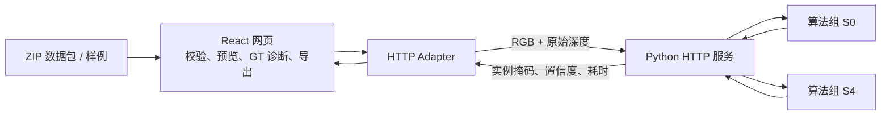

# DPSeg Web Demo

DPSeg 的在线推理与实例分割对比界面。输入一组配准的 RGB-D 图像，分别运行 **S0 基线**和 **S4 改进模型**，在同一视图下检查实例掩码、匹配差异和单图 P–R 曲线。

模型与推理算法来自 [算法组 DPSeg](https://github.com/YuryLee/DPSeg)。本仓库负责网页、HTTP 服务及结果可视化，不包含训练代码和模型权重。

## 与算法组 Demo 的区别

| 项目 | 算法组离线 Demo | 本仓库 Web Demo |
| --- | --- | --- |
| 结果来源 | 先运行算法工具生成预测，再打开 HTML 查看 | 点击“运行对比”，通过 HTTP 服务执行真实推理 |
| 输入 | 页面生成时选定的案例 | 内置样例快捷填入，或上传符合约定的 ZIP |
| 展示重点 | 多组方法及消融结果，支持六组方法对比 | S0 与完整 S4 的案例对比，配合 GT 诊断误检、漏检与边界差异 |
| 运行依赖 | 已生成的页面可离线复制，查看时不需要 GPU | 浏览器无需 GPU；推理主机需运行 CUDA 服务 |
| 部署方式 | 打开生成的 `index.html` | 静态网页与推理 API，可在同一台或不同机器运行 |

两者使用同一算法成果，区别在交互与部署方式。已有案例的离线讲解可直接使用算法组 Demo；本仓库用于现场输入、真实推理和逐实例分析。内置样例也执行真实推理，不读取预先保存的预测。

## 当前功能

- 一次上传 ZIP：RGB、原始深度和可选 GT；样例可快捷填入。
- GT／S0／S4 同步缩放、拖动和复位；无 GT 时展示两个模型预测。
- 误差诊断、置信度过滤、IoU 匹配门槛、全部／小目标筛选及 GT 实例聚焦。
- 单图 P–R 包络、原始曲线、当前工作点、当前 IoU 的 AP 与单图 AP／APₛ。
- 掩码透明度调节、对比图片导出、加载和模型失败状态。

当前已接入真实推理，不包含 mock 回退。单图指标帮助解释当前案例，不能替代完整数据集的实验结论。局部聚焦只改变图片与实例表头，曲线仍统计整图或全部小目标。

## 架构与边界



前端依赖统一的 `DemoBackend.compare()` 接口。ZIP 在浏览器中解压；GT 只用于浏览器本地对照和评测，不发送到推理服务。模型加载、深度预处理和执行由服务器负责，HTTP Adapter 将 COCO 压缩 RLE 转成前端掩码。

## 运行与部署

完整操作见 **[部署指南](docs/deployment.md)**，包含新机器准备、当前主机启动、局域网演示、生产构建和故障排查。

当前这台设备已有运行环境时，在两个 PowerShell 窗口分别执行：

```powershell
# 窗口 1：推理服务，使用当前设备已准备的仓库外环境
& D:\rgbd\deployment\serve.ps1
```

```powershell
# 窗口 2：网页，在本仓库目录执行
Set-Location D:\rgbd\rgbd
npm ci
npm run dev -- --port 5174 --strictPort
```

打开 `http://127.0.0.1:5174/`。笔记本演示时打开 `http://推理主机局域网IP:5174/`；笔记本只需要浏览器。

## 上传格式

```text
case.zip
├── rgb.png      必需：8 位三通道 PNG
├── depth.png    必需：16 位单通道 PNG
└── gt.png       可选：8 或 16 位单通道实例 ID PNG
```

所有图像均为 1024×1024，直接放在 ZIP 根目录，不包含其他文件或嵌套目录。每个文件限 30 MB，ZIP 限 90 MB。GT 的 0 表示背景，不同非零整数表示不同实例，彩色预览图不能作为 GT；当前支持单前景类别、非 crowd 标注。

RGB 与深度须配准，沿用课程相机标定；深度为相机 Z 轴距离，原始值乘 `0.0001` 得到米，0 为无效值。格式通过校验不代表任意实拍场景都具备同等预测效果。

## 指标与交互

绿色表示达到当前 IoU 门槛的匹配预测，红色为误检，黄色虚线为漏检 GT。匹配采用置信度降序和一对一规则。

IoU 改变匹配规则及曲线；置信度仅筛选掩码、移动工作点，不改变 AP。当前 IoU 的 AP 为 101 点插值精确率平均；单图 AP／APₛ 再对 IoU 0.50–0.95、步长 0.05 取平均。每图最多 100 个候选，小目标以原图 GT 面积 ≤1024 像素分组，并使用 COCO 面积忽略规则。后端已过滤的预测不能通过前端滑块恢复。

## 开发

```powershell
npm run check
npm test
npm run build
```

| 目录 | 职责 |
| --- | --- |
| `src/application/` | 输入切换、请求取消、状态与结果校验 |
| `src/backend/` | HTTP 适配器、RLE 转换 |
| `src/components/` | 输入、对比图、控制面板、P–R 曲线 |
| `src/evaluation/` | 单图匹配、P–R 与 AP |
| `src/input/`、`src/upload/` | 图像准备、ZIP 与 GT 校验 |
| `src/viewer/` | 掩码渲染、同步视图与图片导出 |
| `server/service.py` | 常驻模型的推理 HTTP 服务 |
| `scripts/` | 课程样例生成 |

依赖、构建输出、生成样例、本地环境配置不提交。算法源码、权重、Python 环境及运行日志放在仓库外。当前机器上的 `deployment/serve.ps1` 是本地辅助脚本，不随本仓库分发；新机器请按部署指南配置。
